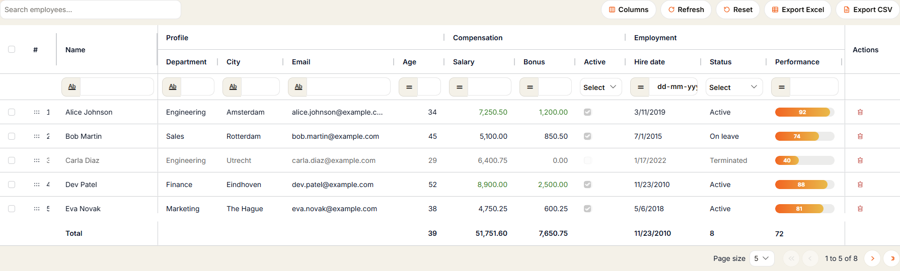
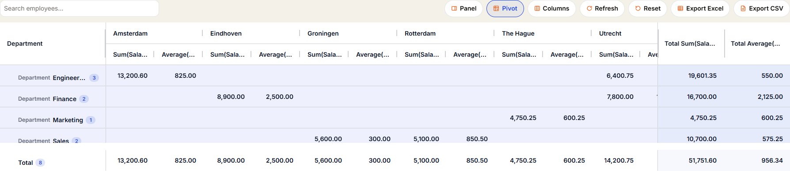
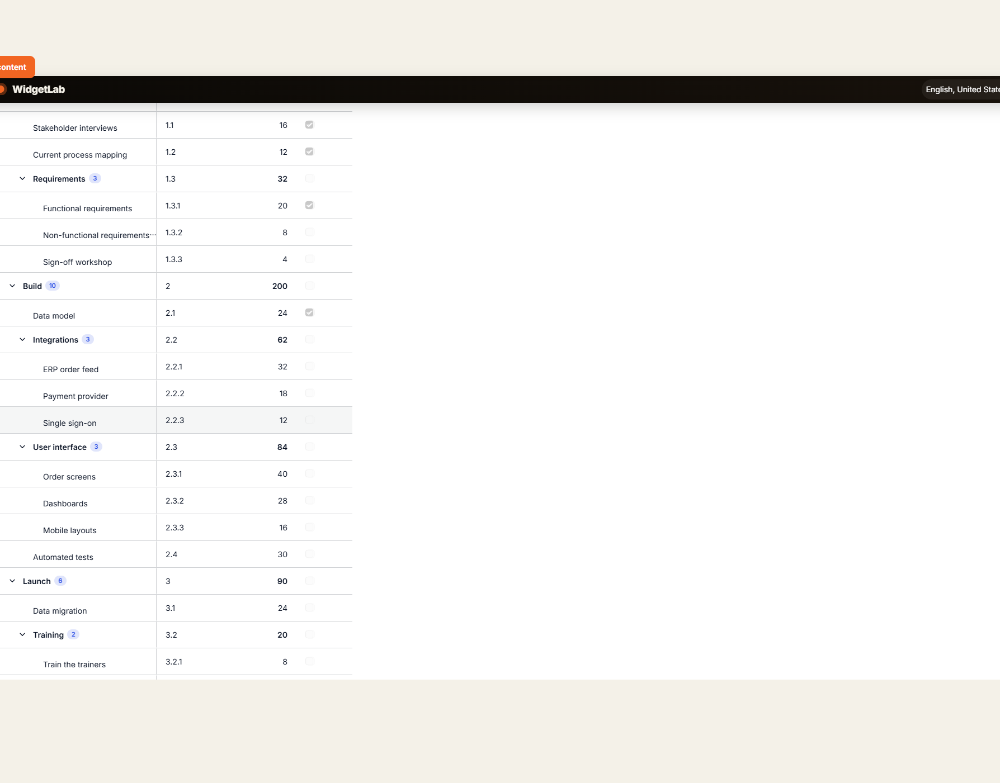
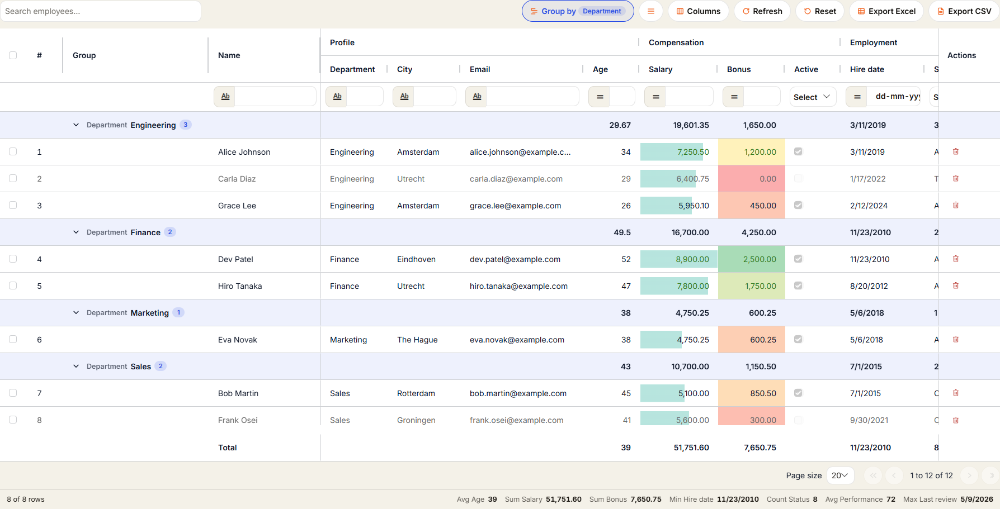
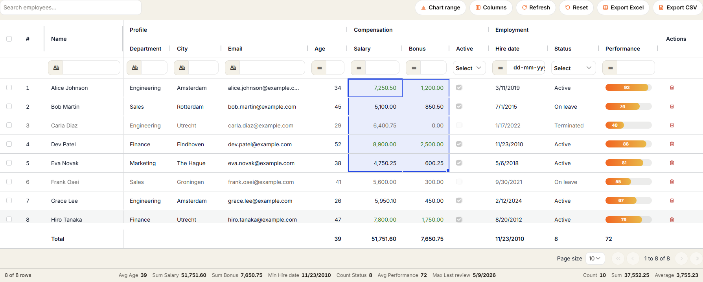
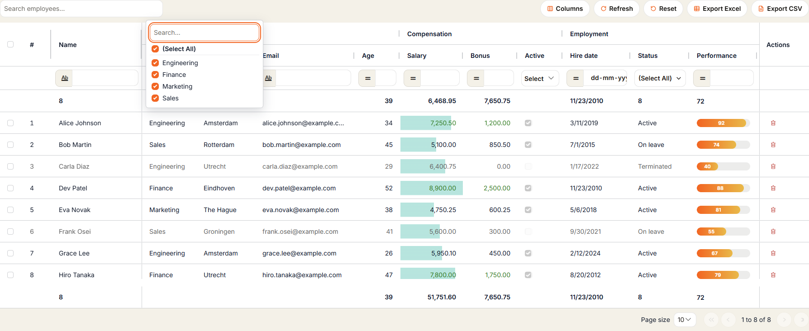
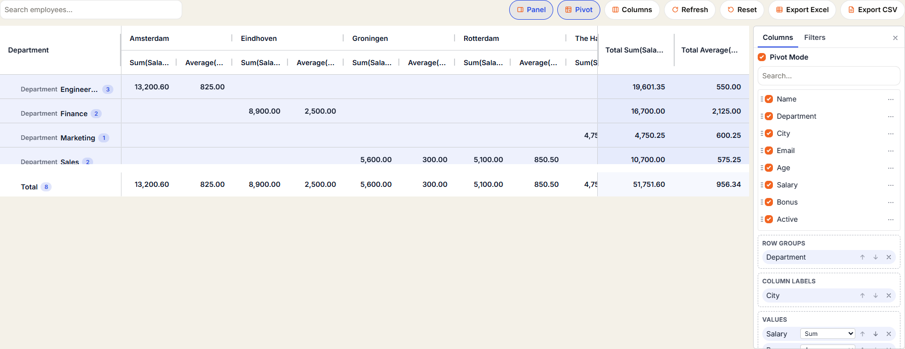
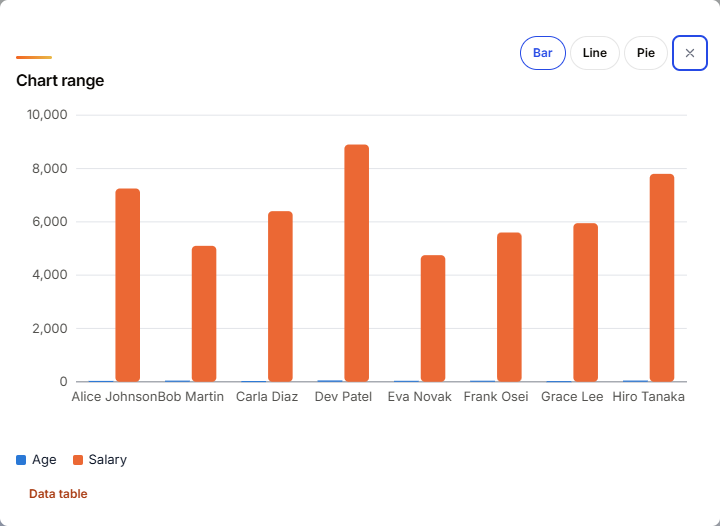
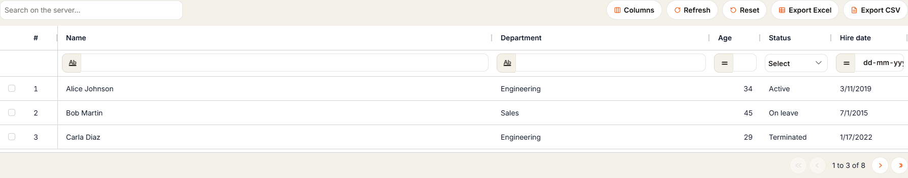

# AG Grid for Mendix (AGGrid widget)

**AGGrid is a free, open-source Mendix pluggable widget that brings AG Grid to Mendix apps**: a fast data grid with
sorting, filtering, inline editing, Excel export, **pivot tables, tree data, row grouping, cell ranges and charts**,
configured entirely from Studio Pro. It is built on AG Grid Community (MIT), so **no AG Grid Enterprise licence is
needed**.

[](https://github.com/bharathidas/AGGrid/releases/latest)
[](LICENSE)


- **Website and documentation:** https://bharathidas.github.io/AGGrid/
- **Download:** [latest release (.mpk)](https://github.com/bharathidas/AGGrid/releases/latest) or the
  [Mendix Marketplace](https://marketplace.mendix.com/link/component/305695)
- **Demo module:** [AGGridDemo](https://github.com/bharathidas/AGGridDemo)
- Mendix 11.0 or newer, web and responsive profiles · Category: Data containers · License: Apache-2.0



## Why use AG Grid in Mendix?

Data Grid 2 covers lists. When users need a spreadsheet-like grid (pivot tables, grouping with subtotals, a tree,
Excel-style ranges and paste, saved views or a styled Excel export), AGGrid gives a Mendix app the AG Grid experience
without custom JavaScript:

- **Drop-in for Mendix**: bind any data source (database, XPath, association, microflow, nanoflow) and add columns.
- **Looks like Data Grid 2** with the Atlas theme, or use the AG Grid Quartz, Alpine, Balham and Material themes.
- **Scales**: Browser mode for instant client-side work, Server mode that pages, sorts and filters on the database.
- **Enterprise-grade features on the free Community edition**: pivot, tree data, grouping, ranges and charts are
  implemented by the widget itself.

## What's new in version 1.1.0

| Area | New in 1.1.0 |
| --- | --- |
| Analysis | **Pivot mode** (row groups x column labels x values, subtotals, grand totals), **row grouping** up to three levels with aggregates, **lazy server-side groups**, **tree data** (parent key or path), status bar, top and bottom totals rows, distinct count |
| Spreadsheet feel | **Cell range selection**, copy as TSV, **fill handle** (copy and series), Ctrl+D, **paste from Excel**, **chart range** (bar, line, pie) |
| Filtering and layout | **Set filter** (checkbox list with search and blanks), **side panel** (columns and filters), **saved views** per user, density button, search highlight |
| Data entry | **Cell validation** with an issues badge, hold commits while invalid, **expandable detail rows** with any widgets |
| Presentation | **Conditional formatting** (data bars, colour scales, icon sets), **sparklines**, lively loading and change effects |
| Export | **Styled Excel** (header fill, widths, frozen panes, native conditional formats, SUBTOTAL totals) with extra Pivot and Selection sheets |
| Reliability | Error boundary with Retry, failed-save banner with Retry and Discard, right-to-left support, 133 unit tests |

Full details: [CHANGELOG.md](CHANGELOG.md). Upgrading from 1.0.0 is a drop-in replacement: every new feature is off
by default, only the Excel file is styled by default.

## Features already in 1.0.0

- Data source binding with **Browser** or **Server** data loading (paging, sorting and filtering on the database).
- Attribute, dynamic text and custom content (any widgets) columns; render as text, link, badge, progress bar or image.
- Multi-column sorting, **floating filters** with the Data Grid 2 operator menu, **quick search**, pagination.
- **Inline editing** with undo/redo and three commit modes (keep in client, commit directly, On commit microflow).
- Single and multi **selection** through the Mendix selection API, select all, selection counter.
- Column **pinning**, hiding, resizing, reordering, a column chooser and a remembered layout.
- **Row drag** with an order attribute, a **totals row**, **Excel (.xlsx) and CSV export**.
- Atlas (Data Grid 2 look), Quartz, Alpine, Balham and Material themes; eleven built-in languages.

## Screenshots

| | |
| --- | --- |
|  **Pivot table** |  **Tree data** |
|  **Row grouping** |  **Cell ranges and fill handle** |
|  **Set filter** |  **Side panel** |
|  **Chart range** |  **Server data loading** |

## Installation

1. Download `com.mxtechies.widget.web.AGGrid.mpk` from the
   [latest release](https://github.com/bharathidas/AGGrid/releases/latest) or the
   [Mendix Marketplace](https://marketplace.mendix.com/link/component/305695).
2. Put it in the `widgets` folder of your Mendix app and press **F4** (App > Synchronize App Directory) in Studio Pro.
3. Find **AGGrid** in the toolbox under *Data containers* and drop it on a page.

## FAQ

**How do I use AG Grid in Mendix?**
Install the AGGrid widget (above), drop it on a page, choose a data source and add columns. Sorting, filtering,
paging, editing and export are switched on with Studio Pro properties; no JavaScript is needed.

**Is AGGrid free? Do I need an AG Grid Enterprise licence?**
Yes, it is free and open source (Apache-2.0). It bundles only AG Grid Community (MIT). Pivot, tree data, grouping,
ranges, set filters and the styled Excel export are implemented by the widget, so no Enterprise licence key is used.

**AGGrid or Data Grid 2?**
Data Grid 2 is the standard Mendix list grid. Choose AGGrid when users need pivot tables, grouping with subtotals,
tree data, Excel-like ranges, fill and paste, saved views, conditional formatting or a styled Excel export. With the
Atlas theme it looks like Data Grid 2, so both can sit on the same page.

**Does it work with large data sets?**
Yes. Server data loading pages, sorts and filters on the database like Data Grid 2, so any number of rows works.
Browser loading suits lists up to some thousands of rows and makes every interaction instant.

**Which Mendix versions are supported?**
Mendix 11.0 and newer, web and responsive navigation profiles. Native mobile is not supported.

**Can users export to Excel?**
Yes: a real .xlsx file with typed numbers and dates, frozen header, auto filter, and (from 1.1.0) styled headers,
native conditional formats, SUBTOTAL totals and extra Pivot and Selection sheets. CSV is available too.

## Usage

1. Drop **AGGrid** on a page and choose a **Data source** (database, XPath, association, microflow or nanoflow).
2. Add **Columns**. Each column shows an attribute, a dynamic text expression, or custom content (any widgets, rendered per row).
3. Optionally turn on **Selection**, make columns **Editable**, enable the **Totals row**, **Row drag**, or bind a **Column state attribute** to remember the user's layout.
4. New in 1.1: [Saved views](#saved-views), [Detail rows](#detail-rows), [Cell validation](#cell-validation),
   [Row grouping](#row-grouping-new-in-11), [Pivot mode](#pivot-mode-new-in-11), [Tree data](#tree-data-new-in-11),
   [Cell ranges, fill handle and charts](#cell-ranges-fill-handle-and-charts-new-in-11), [Set filter](#set-filter-new-in-11),
   [Side panel](#side-panel-new-in-11), [Totals rows](#totals-rows-new-in-11), [Excel export](#excel-export-new-in-11),
   [Lazy server groups](#lazy-server-groups-new-in-11) and [Reliability](#reliability-new-in-11).

## Properties

### General

| Group | Property | Purpose |
| --- | --- | --- |
| Data source | Data source | The objects shown as rows |
| Data source | Data loading | Browser (all rows loaded once, everything happens in the browser) or Server (the data source pages, sorts and filters like Data Grid 2) |
| Data source | Max rows to load | Browser loading only: limit for the data source, 0 loads all objects |
| Data source | Refresh time | Reloads the data source every n seconds |
| Columns | Columns | The column list, see below |
| Selection | Selection | None, Single or Multi. Uses the Mendix selection API, so it works with Select by / listen-to widgets |
| Selection | Selection checkboxes, Select all checkbox, Select on row click | How rows are selected |

### Column

| Group | Property | Purpose |
| --- | --- | --- |
| Content | Show | Attribute, Dynamic text (expression per row) or Custom content (widgets per row) |
| Content | Caption, Header group, Tooltip | Header text, spanning group header for adjacent columns, tooltip expression |
| Content | Render as | Text, Link (opens the value as a URL), Badge (Atlas badge, colored through the cell class), Progress bar (0-100), Image (value is an image URL) or Sparkline (a text value with numbers such as `3,5,4,8,7` drawn as a trend line) |
| Content | Attribute name (editing) | Only for inline editing when several attributes of the same type hold the same values in all loaded rows and the widget cannot tell which one to write |
| Content | Total from data source | Attribute of the totals data source shown in the totals row (when Totals from is Data source) |
| Size | Width | Flex (share of free space), Fixed (px) or Auto (fit content); Min and Max width |
| Behavior | Sortable, Filter | Sorting and the filter type (auto, text, number, date, none) |
| Behavior | Editable | Boolean expression per row. Values are written to the attribute immediately, Mendix validation is shown on the cell |
| Behavior | Pinned, Visible, Resizable, Movable | Column state options |
| Behavior | Totals row value | Sum, Average, Minimum, Maximum or Count for the totals row |
| Grouping | Group by level, Users can group by this column | Starting grouping level (0 = none, 1-3) and whether the column is listed in the Group by menu (Features > Grouping) |
| Validation | Validation | String expression per row: an error message when the cell is invalid, empty when valid. Invalid cells are outlined, show the message as tooltip and count in the toolbar issues badge |
| Appearance | Alignment, Wrap text, Auto row height, Cell class | Cell styling; cell class is an expression per row |
| Appearance | Conditional format, Data bar color, Lower is better | Number columns: data bars, a red-yellow-green color scale or an up/flat/down icon set, scaled over the loaded rows |
| Events | On click, On change | Per-column actions with the row object |

### Features

| Group | Property | Purpose |
| --- | --- | --- |
| Toolbar | Quick search, Search placeholder, Search attribute | Search box above the grid; the attribute lets another widget drive the search |
| Toolbar | Export button, Export format, Export file name | Downloads the filtered and sorted rows as Excel (.xlsx with real numbers, dates and booleans, bold frozen header, auto filter), CSV, or both; in server mode all matching rows are fetched first |
| Toolbar | Reset button, Refresh button | Clears filters, sorting and layout; reloads the data source. All toolbar buttons show an inline icon next to their label |
| Toolbar | Columns button, Selection count | Show/hide columns from a checklist; "n rows selected" with a Clear button |
| Toolbar | Density button | Compact / normal / comfortable rows, remembered with the layout |
| Toolbar | Keyboard help button | Button with a popover that lists the keyboard shortcuts (also Shift+? in the grid) |
| Sorting and filtering | Multi sort without Shift, Floating filters | Sorting on several columns, filter inputs under the headers |
| Pagination | Pagination, Page size, Page size choices, Auto page size | Client-side paging |
| Editing | Edit mode, Single click edit, Undo / redo, Enter moves down, Flash changed cells | Editing behavior |
| Editing | Commit, On commit | What happens after an edit: Keep in client (a Save button commits later), Commit directly (the widget saves the object), or Run On commit action (the changed object is passed to a microflow or nanoflow together with the New value, Old value and Attribute name variables) |
| Editing | Paste from Excel | Ctrl+V pastes a copied block into the editable cells from the focused cell down and right (a single value fills the selected rows); values are converted per column type, misfits are skipped, one Ctrl+Z undoes the paste |
| Editing | Hold commits while invalid | Commit directly / Run On commit action only: an object with validation issues is not committed and On commit does not run until the object is valid again; then the held commit runs by itself |
| Columns | Auto size, Remember layout in, Layout attribute | Auto size strategy; layout (order, widths, pinning, visibility, sort, filters, search text) remembered nowhere, in browser storage, or in a String attribute. A remembered layout is dropped automatically when the column configuration changes |
| Saved views | Views menu, Views attribute, Browser storage key | Toolbar Views menu with named layouts per user, stored as JSON in a String attribute or in browser local storage |
| Detail rows | Detail content, Expand, Start collapsed, Detail height | Widgets in an expandable full-width row under each row; one or several rows at a time; fixed or fitted height |
| Grouping | Row grouping, Groups start expanded, Hide grouped columns | Group by up to three columns from a toolbar menu; collapsible group rows with counts and the column aggregates (Browser loading) |
| Status bar | Status bar | Shown / total / selected rows and the column aggregates of the selection (or of all shown rows) |
| Row drag | Row drag, Order attribute | Drag handle in the first column; the new position (1-based) is written to the order attribute |

### Appearance

| Group | Property | Purpose |
| --- | --- | --- |
| Theme | Theme, Color scheme, Accent color, Font size, Spacing | Quartz, Alpine, Balham or Material; light, dark or auto |
| Layout | Height, Grid height, Row height, Header height, Wrap header text | Fixed height, auto height or print layout |
| Rows | Row numbers, Animate rows, Highlight row / column on hover, Allow text selection, Row class | Row options; row class is an expression per row |
| Rows | Motion, Highlight search matches | Full / subtle / off motion; marks the quick search text in the cells |
| Rows | Lively effects | Skeleton rows while loading, refresh progress bar, highlight of rows changed by a refresh, animated empty state with Clear filters, soft transitions (default on; always off for reduced motion) |
| Totals row | Totals row, Totals label, Totals from, Totals data source | Pinned totals row at the top or bottom, computed over the filtered rows, or taken from the first object of a totals data source (a microflow that aggregates on the server) |
| Labels | Columns, Refresh, Reset, Excel, CSV button labels, Selection count text, Clear selection label, Page size label, Paging status text | Translatable texts of the toolbar and the Atlas pager; [count], [first], [last] and [total] are replaced |
| Labels | Views button label, Save view label, Issues badge text, Show details label, Clear filters label, Keyboard help label | Translatable texts of saved views, validation, detail rows and keyboard help; [count] is replaced in the issues badge |
| Labels | Group by label, Group column header, Density label, Status bar rows text | Translatable texts of grouping, density and the status bar; [shown] and [total] are replaced in the status bar |
| Messages | No rows text, Empty placeholder | Message, or any widgets, shown for an empty grid |

### Events

| Property | Purpose |
| --- | --- |
| On row click, On row double click | Actions with the clicked row object. A column On click wins for its cells |
| On selection change | Runs after the selection changed |
| On cell value change | Runs after any edited value was written; column On change runs first. Both actions receive the New value and Old value variables as text |
| On commit | Runs with the changed object when Commit is set to Run On commit action; receives New value, Old value and Attribute name |
| On row drag end | Runs after rows were reordered; the order attribute is already updated |
| On group by change | Runs after the user changed the grouping; the Group by variable holds the captions, e.g. `Department > City` |
| On paste | Runs once after a paste; the Cell count variable holds the number of changed cells |

## Saved views

Users keep named layouts of the grid and switch between them from the toolbar.

1. Set **Features > Saved views > Views menu** to Yes.
2. Choose where views are stored:
   - **Browser storage** (nothing to model): leave **Views attribute** empty. Views are kept per browser under
     `mxt-aggrid-views:<Browser storage key>`; the key defaults to the widget name. Give several grids the same key
     to share views between them.
   - **Per user, across browsers**: select a String attribute with **unlimited** length on a context object as
     **Views attribute**, for example `GridViews` on a per-user settings object that you retrieve or create for the
     current user and commit when the page closes (or with a Save button). The widget writes the views there as JSON.
3. At runtime the **Views** button lists the saved views. **Save current view as...** stores the current column
   order, widths, visibility, pinning, sorting, filters and search text under a name. The star marks the default view,
   which opens when the page loads (it wins over **Remember layout in**); the pencil renames and the bin deletes a view.
   While the grid differs from the active view a dot appears on the button and the menu offers **Update "name"**.
4. A view saved before the columns of the grid changed is marked **Outdated**; applying it only restores the search
   text. A read-only views attribute still lets users apply views but not change them.

## Detail rows

1. Drop widgets in the **Detail row** drop zone of the grid (Studio Pro shows it under the sample rows); they get the
   row's object as context, just like custom content columns. Data views, list views, text, buttons, charts or even a
   nested grid over an association work.
2. Choose **Expand**: One row at a time (expanding a row collapses the previous one) or Several rows.
3. **Start collapsed** off expands the first row (one at a time) or all rows (several rows) on load.
4. **Detail height** 0 fits the content (the row grows and shrinks with it); a fixed height makes the detail scroll.

Users expand a row with the chevron, Enter or Space on the chevron cell, or Alt+Down / Alt+Up on any cell of the
row. Detail rows need Browser data loading, they are part of the paged rows, and they are never selected, exported,
counted in totals or numbered.

## Cell validation

1. Enter a **Validation** expression on a column (Behavior tab): return the error message when the value is invalid
   and an empty text when it is valid, for example
   `if $currentObject/Salary < 0 then 'Salary cannot be negative' else ''`. Rules over several attributes work too,
   for example on Bonus: `if $currentObject/Bonus > $currentObject/Salary then 'Bonus exceeds salary' else ''`.
2. Invalid cells get a red outline and corner and show the message as tooltip; Mendix validation feedback on the
   attribute counts as an issue too.
3. The toolbar shows **Issues: N** while there are invalid cells in the filtered rows. Click it, or press F8 /
   Shift+F8 in the grid, to move to the next / previous invalid cell (pages are switched when needed). Screen readers
   hear the message of the focused invalid cell.
4. Optionally turn on **Features > Editing > Hold commits while invalid** (with Commit set to Commit directly or Run
   On commit action). An edited object that has issues is then not committed and On commit does not run; once the
   object is valid again (for example after the user fixed the value) the held commit, and each held On commit call,
   runs by itself. The badge shows how many objects are unsaved.

## Row grouping (new in 1.1)

AG Grid Community has no row grouping (it is an AG Grid Enterprise feature), so AGGrid brings its own:
**Features > Grouping > Row grouping** adds a **Group by** toolbar menu with the groupable columns. Pick up to three
columns, change their order with the arrows, expand or collapse every group, or ungroup. A pinned **Group** column
shows the group rows with a chevron, the column caption, the value and the number of rows; the other cells of a group
row show the column's *Totals row value* (sum, average, minimum, maximum or count) for the rows in the group.

- Groups follow the filters and the quick search (counts and aggregates are recalculated, empty groups disappear)
  and sort ascending, or descending when the user sorts the grouped column descending.
- Keyboard: on the group cell, Enter or Space toggles the group, Arrow Right opens and Arrow Left closes it.
- Exports: Excel writes group header rows in bold with Excel outline levels (collapsible in Excel); CSV writes the
  data rows only. Both include rows of collapsed groups.
- The grouping is part of the remembered layout and of saved views. Reset returns to the configured grouping.
- Browser data loading only. Row drag is switched off while the grid is grouped.

## Paste from Excel, status bar, conditional formats (new in 1.1)

- **Paste from Excel** (Features > Editing): copy cells in Excel, focus a grid cell, press Ctrl+V. Numbers accept
  `1,234.50`, `1.234,50`, `12%` and currency signs; booleans accept Yes/No/true/false/1/0 and the app captions;
  dates accept ISO and the locale's day/month order; enumerations accept keys or captions. Cells that are read-only
  or whose text does not fit are skipped and counted in the screen reader announcement.
- **Status bar** (Features > Status bar): "12 of 120 rows", "3 selected" and, for each column with a Totals row
  value, the aggregate of the selected rows (all shown rows when nothing is selected). Counts count up smoothly.
- **Conditional format** (column > Appearance): data bars start at zero so negative values grow left; the color
  scale and icon set can be reversed with *Lower is better*.
- **Search highlight**: matches of the quick search are marked with the CSS Custom Highlight API, so the cell markup
  never changes (Chrome/Edge 105+, Safari 17.2+, Firefox 140+; other browsers show no marks).
- **Density button**: compact, normal and comfortable rows; remembered with the layout and saved views.
- **Motion** (Appearance > Rows): *Full* (all Lively effects, count-ups, row flashes), *Subtle* (fades only) or *Off*.

## Pivot mode (new in 1.1)

**Features > Pivot > Pivot mode** lets users turn the grid into a pivot table (an AG Grid Enterprise feature that
AGGrid implements itself on top of AG Grid Community). A **Pivot** toolbar button switches it on and off; the layout is
made in the side panel (**Features > Side panel**) by dragging columns, or with each column's **⋯** menu, into:

- **Row groups**: one or more columns whose values become the (nested) pivot rows, with subtotal rows per level;
- **Column labels**: columns whose values become generated columns (nested header groups for several levels);
- **Values**: the aggregated columns, each with its own function: sum, average, count, minimum, maximum or distinct
  count (sum and average are offered for number columns).

With **Pivot totals** a total column per value and a grand total row are added. The pivot uses the rows that pass the
column filters and the quick search (filters stay editable in the side panel's Filters section and the search box),
siblings can be sorted by clicking a pivot header, and groups collapse with the chevron or Enter / Arrow keys. The pivot
layout and the pivot on/off state are kept in the remembered layout and in saved views. The Excel export adds a
**Pivot** sheet (column labels as header rows, outline levels for the row groups, bold subtotals and grand total).
Configure a starting layout per column with **Pivot start role** / **Pivot value function** and **Start in pivot mode**.

Limits: browser data loading only; at most 400 generated value columns are shown (a notice tells when more column-label
combinations exist); pivot cells are read-only.

## Tree data (new in 1.1)

**Features > Tree data** shows the rows as a hierarchy:

- **Key and parent key**: a Key expression (unique per row) and a Parent key expression (empty for top-level rows).
  The parent key may follow an association, e.g. `$currentObject/MyModule.Task_Parent/MyModule.Task/Code`. Rows whose
  parent is not loaded become top-level rows, and parent cycles are broken.
- **Path**: one expression that returns the path, e.g. `Europe/Norway/Oslo` (separator configurable). Missing levels
  are generated as summary rows.

A pinned tree column shows indentation, a chevron with `aria-expanded`, the label (**Label** expression, else the last
path part or the key) and the number of rows below. Enter / Space toggle, Arrow Right opens, Arrow Left closes;
toolbar buttons expand or collapse everything; **Open levels** sets how deep the tree starts open. Sorting sorts siblings
and keeps the hierarchy. Filtering and the quick search keep the **ancestors** of matching rows (shown in a quieter,
italic style) so a match never loses its context. **Aggregate per parent** shows the column's Totals row value (sum,
average, ...) of all descendants on parent rows; generated path rows always do. Excel and CSV exports add a
Hierarchy column (Excel with outline levels). Browser data loading only; grouping, pivot and detail rows are not
available while tree data is on.

## Cell ranges, fill handle and charts (new in 1.1)

**Features > Range selection > Cell range selection** adds spreadsheet-style ranges:

- Drag over cells, Shift+click, or Shift+arrow keys to select a block (data columns only; system columns are skipped).
- **Ctrl+C** copies the range as tab-separated text (rows separated by CRLF), which pastes as a block into Excel.
  With one copied value, Ctrl+V fills the whole selected range (Paste from Excel on).
- The status bar (or a small range bar when the status bar is off) shows **Count, Sum and Average** of the range.
- **Fill handle**: drag the small square at the bottom right of the range down or to the right. Two or more numbers or
  dates continue as a linear series (1, 2 → 3, 4; dates by their step), texts ending in a number count on
  (Item 1 → Item 2), everything else is copied. Hold Ctrl to swap copy and series. **Ctrl+D** fills down from the first
  row of the range. Every fill writes through the normal editing path (valueSetter, commit mode, On commit, column
  On change), skips read-only cells and values that do not fit a column, is one **Ctrl+Z** step, and runs **On fill**.
- **Chart range** (toolbar, Alt+F1): a dialog with a bar, line or pie chart of the range: the first text column gives
  the categories, every number column a series (up to 8; a pie shows the first series, the smallest slices fold into
  "Other"). The chart is plain SVG with a legend, tooltips per mark and a **Data table** toggle (the table is always
  available to screen readers); it follows the light/dark scheme and Motion.
- The Excel export adds a **Selection** sheet with the range.

## Set filter (new in 1.1)

Set a column's **Filter** to **Set (checkbox list)**: the floating filter becomes a button that opens a checklist of the
distinct values with a search box, **(Select all)** (selects or clears the values that match the search) and
**(Blanks)**. Enumerations and booleans list every caption. Long lists show the first 500 values and ask the user to
search. The filter is part of the filter model, so it is remembered, saved in views, cleared by Reset and shown in the
side panel. With Server data loading a set filter is sent to the data source for enumeration and boolean columns; for
other types it falls back to a text filter (the distinct values of millions of rows cannot be listed).

## Side panel (new in 1.1)

**Features > Side panel** adds a **Panel** toolbar button (optionally **Start open**) with two tabs:

- **Columns**: search, show/hide checkboxes, reorder by dragging or with Alt+Arrow keys / Move up / Move down, the
  **Row groups** zone (row grouping, or the pivot rows in pivot mode), and in pivot mode the **Pivot mode** switch and the
  **Column labels** and **Values** zones with the function per value. Every drag action has a keyboard equivalent in the
  column's **⋯** menu.
- **Filters**: every filterable column with its set filter checklist or a condition editor (operator + value),
  an active marker, Clear per column and a counter on the tab.

Whether the panel is open and which tab is shown are kept in saved views. On narrow screens the panel moves under the grid.

## Totals rows (new in 1.1)

**Appearance > Totals row** can now be **Top and bottom**: the bottom row uses the column's Totals row value, the top
row the column's **Top totals row value** (e.g. average on top, sum at the bottom). **Distinct count** joins the
functions (totals, groups, status bar, pivot). With **Users can change totals** a click (or Enter, Space, Alt+Down) on a
totals cell opens a menu to pick sum, average, minimum, maximum, count, distinct count or nothing for that column; the
choice is kept with the layout and in saved views. Totals always follow the filters and the quick search.

## Excel export (new in 1.1)

- **Excel sheets = Data and more** (default): the Data sheet plus a **Pivot** sheet while the pivot is shown and a
  **Selection** sheet while a cell range is selected. **Data only** writes one sheet like 1.0.0.
- **Styled Excel** (default on): header fill, column widths as shown in the grid, frozen header and pinned-left columns,
  number and date formats, the columns' conditional formats as native Excel **data bars, 3-color scales and icon
  sets**, and the totals rows as `SUBTOTAL` formulas (so they follow Excel's own filter). Off writes the plain 1.0.0 file.

## Lazy server groups (new in 1.1)

With **Server** data loading, **Features > Grouping > Lazy server groups** lets users group by **one enumeration or
boolean** column. The grid then:

1. asks the data source for the size of each group (one small request per enumeration value and one for empty),
2. loads the rows of a group page by page (Page size rows per page) when it is expanded, with a **Load more** row,
3. applies the column filters, the quick search and the sort order to every request, and reloads the groups when they change.

Honest limits: only enumeration and boolean columns (their values are known up front; a list data source cannot return
the distinct values of a text or number attribute), one level, requests run one after another through the single
Mendix data source (setFilter / setOffset / setLimit), rows inside lazy groups are read-only snapshots, and the
totals row and status bar only cover the loaded rows. The CSV/Excel export fetches all matching rows (up to 50,000).

## Reliability (new in 1.1)

- **Error boundary**: an unexpected error inside the grid shows a message with a **Retry** button (Labels > Error text)
  instead of a broken page; Retry draws the grid again.
- **Slow and failed saves**: inline edits, pastes and fills that commit (Commit directly) are tracked. A save that takes
  longer than 4 seconds shows "Saving..."; a failed write or commit shows a banner (role=alert) with the number of
  changes, the error, **Retry** and **Discard** (rolls the cells back to their old values). Nothing is dropped silently.
- **Right to left**: on pages with `dir="rtl"` the grid, side panel, ranges and menus mirror (AG Grid `enableRtl`).
- Tested: unit tests including performance budgets on 10,000 rows, a jsdom smoke test, and two browser suites
  (52 + 116 checks) with a mount/unmount memory check, contrast checks in light and dark, 200% zoom and RTL.
- A CycloneDX SBOM is written to `dist/<version>/sbom.cdx.json` by `npm run sbom`.

## Lively effects

**Appearance > Rows > Lively effects** (on by default) adds:

- skeleton rows instead of an empty grid while the data loads for the first time (Browser and Server loading);
- a slim progress bar at the top of the grid while rows that are already shown refresh;
- a short highlight (accent bar and flash) on rows that changed or appeared after a data refresh, such as the
  refresh timer, a microflow or another user's change; the user's own edits are not highlighted twice;
- a friendly animated empty state; when filters or the search hide every row it offers a **Clear filters** button
  (the Empty placeholder widgets still take precedence when configured);
- soft toolbar, menu, badge and detail row transitions.

Users who set "reduce motion" in their operating system get no animations from the widget, whatever the setting
(this also turns off AG Grid's row animation). Turn Lively effects off to get the 1.0 overlays back.

## Keyboard

| Keys | Action |
| --- | --- |
| Ctrl+V | Paste a copied block (Paste from Excel property); one value fills a selected range |
| Shift+Arrow keys / Shift+click | Extend the cell range (Cell range selection) |
| Ctrl+C (range) | Copy the range as tab-separated text |
| Ctrl+D | Fill down from the first row of the range |
| Alt+F1 | Chart the selected range |
| Esc | Clear the range, close menus and dialogs |
| Enter / Arrow Right / Arrow Left | On a tree cell: toggle, open or close the row |
| Enter, Space or Alt+Down on a totals cell | Change the totals function (Users can change totals) |
| Alt+Arrow Up / Down | In the side panel column list: move the column |
| Enter / Arrow Right / Arrow Left | On a group cell: toggle, open or close the group |
| Ctrl+C / Ctrl+Shift+C | Copy the focused cell / the focused row as tab-separated text (paste it into Excel) |
| Ctrl+Z / Ctrl+Y | Undo / redo cell edits (Undo / redo property) |
| F8 / Shift+F8 | Next / previous invalid cell |
| Alt+Down / Alt+Up | Show / hide the details of the focused row |
| / | Focus the search box |
| Shift+? | Open the keyboard help popover (Keyboard help button property) |

## Look and feel

The default **Atlas (Data Grid 2 look)** theme uses the app font, a white bold header, thin gray row lines, the Atlas brand color
and a Data Grid 2 style paging bar, so the grid blends in next to Data Grid 2. The AG Grid themes (Quartz, Alpine, Balham,
Material) are available too, each with a light, dark or automatic color scheme. Accent color, font size and spacing can be
overridden for every theme.

## Inline editing

Values edited in the grid are written to the object immediately, like a text box in a Data Grid 2 custom content column.
The pluggable widget API does not allow writing attributes that come from a data source yet, so the widget falls back to
the Mendix client API; the change is client-side until it is committed. Use the column **On change** or grid
**On cell value change** action (for example a nanoflow with a Commit) to persist the edit, or commit from a Save button.

## Browser or server data loading

- **Browser** loads the rows once (optionally capped) and does everything in AG Grid: instant sorting, filtering,
  quick search, totals over the filtered rows, row drag. Best for lists up to some thousands of rows.
- **Server** works like Data Grid 2: each page is retrieved from the data source with the current sort order, column
  filters and quick search translated to a Mendix filter, so it scales to any number of rows. Dynamic text and custom
  content columns cannot sort or filter in this mode, the totals row only covers the loaded rows, and row drag is off.

## Notes

- In Studio Pro the widget previews with the Data Grid 2 markup and classes, so it looks like a Data Grid 2 on the page
  editor; columns can be selected in the preview.
- With the Atlas theme the filter row looks like Data Grid 2: an operator button (contains, equal, greater than, ...) with the Data Grid 2 icons and an input for text, number and date columns, and a Select dropdown with the captions for enumeration and boolean columns.
- AG Grid texts (filter menus, overlays) follow the Mendix session language for English, Dutch, German, French, Spanish,
  Italian, Portuguese (incl. Brazil), Polish, Turkish, Japanese and Chinese.
- Row drag with pagination: AG Grid only animates rows while dragging when pagination is off. With pagination the row
  is dropped on the row under the pointer, and the order attribute is written either way.

- Enumeration cells show captions, sort and filter by caption, and edit with a dropdown of the enumeration values.
- Boolean cells render as checkboxes; Date cells use the AG Grid date editor and date filter.
- Number and date formatting follows the Mendix formatter of the attribute, so decimals, grouping and locale match the rest of the app.
- Custom content columns are not sortable or filterable, because their value is a widget tree.
- The CSS classes `mxt-ag-grid`, `mxt-ag-toolbar`, `mxt-ag-btn`, `mxt-ag-icon`, `mxt-ag-cell-invalid`, `mxt-ag-row-totals`, `mxt-ag-rownum`, `mxt-ag-menu`, `mxt-ag-issues`, `mxt-ag-detail`, `mxt-ag-detail-toggle`, `mxt-ag-skeleton`, `mxt-ag-empty-state`, `mxt-ag-row-changed`, `mxt-ag-row-group`, `mxt-ag-group`, `mxt-ag-status`, `mxt-ag-cf-bar`, `mxt-ag-cf-scale`, `mxt-ag-cf-icon--up|flat|down` and `mxt-ag-spark` are available for theming; `--mxt-ag-accent` colors the progress bar, chevron focus and detail accent. AG Grid theme variables (`--ag-*`) can be overridden on `.mxt-ag-grid` as usual.

## Development

```
npm install
npm run build      # builds dist/<version>/*.mpk and copies it to the app's widgets folder
npm run lint
npm test           # unit tests, performance budgets (10,000 rows) and jsdom smoke tests of the whole grid
npm run harness    # browser harness (esbuild bundle + headless Chrome; suites test.mjs 52 and test13.mjs 116 checks)
npm run sbom       # CycloneDX SBOM into dist/<version>/sbom.cdx.json
npm run licenses   # licence check of the bundled packages, writes THIRD-PARTY-LICENSES.md
npm run release    # production build
```

Node 22.18 is pinned; `zip-a-folder` is pinned to 6.1.4 for that Node version.
