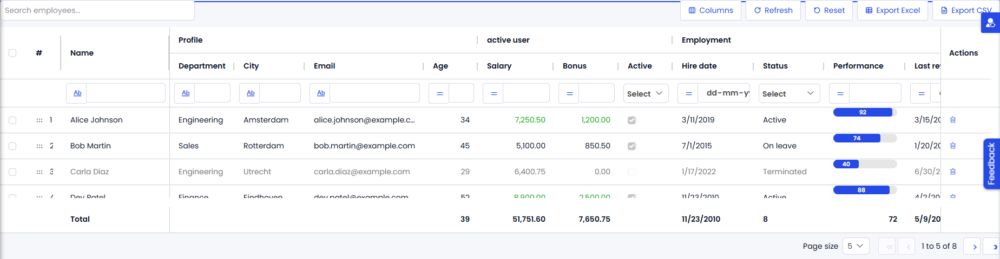

# AGGrid

> A Mendix data grid powered by AG Grid Community: sorting, filtering, quick search, pagination, inline editing, selection, pinning, reordering, row drag, CSV export, totals and themes.

A Mendix pluggable widget that wraps [ag-grid-react](https://www.npmjs.com/package/ag-grid-react) (AG Grid Community edition, MIT licensed). Every feature of the open-source edition that makes sense in a Mendix page is exposed as a Studio Pro property; nothing from AG Grid Enterprise is used.

- Mendix 11.0 or newer, web only
- Category: Data containers
- License: Apache-2.0 (AG Grid Community is MIT)



## Installation

Download `com.mxtechies.widget.web.AGGrid.mpk` from the
[latest release](https://github.com/bharathidas/MxTechiesAGGrid/releases) (or the Mendix Marketplace)
and drop it into the `widgets` folder of your app, then press F4 in Studio Pro.

## Usage

1. Drop **AGGrid** on a page and choose a **Data source** (database, XPath, association, microflow or nanoflow).
2. Add **Columns**. Each column shows an attribute, a dynamic text expression, or custom content (any widgets, rendered per row).
3. Optionally turn on **Selection**, make columns **Editable**, enable the **Totals row**, **Row drag**, or bind a **Column state attribute** to remember the user's layout.

All sorting, filtering and pagination happen in the browser on the loaded rows. Use **Max rows to load** to cap the number of objects retrieved, or leave it at 0 to load everything.

## Properties

### General

| Group | Property | Purpose |
| --- | --- | --- |
| Data source | Data source | The objects shown as rows |
| Data source | Data loading | Browser (all rows loaded once, everything happens in the browser) or Server (the data source pages, sorts and filters like Data Grid 2) |
| Data source | Max rows to load | Browser loading only: limit for the data source, 0 loads all objects |
| Data source | Refresh time | Reloads the data source every n seconds |
| Columns | Columns | The column list, see below |
| Selection | Selection | None, Single or Multi. Uses the Mendix selection API, so it works with Select by / listen-to widgets |
| Selection | Selection checkboxes, Select all checkbox, Select on row click | How rows are selected |

### Column

| Group | Property | Purpose |
| --- | --- | --- |
| Content | Show | Attribute, Dynamic text (expression per row) or Custom content (widgets per row) |
| Content | Caption, Header group, Tooltip | Header text, spanning group header for adjacent columns, tooltip expression |
| Content | Render as | Text, Link (opens the value as a URL), Badge (Atlas badge, colored through the cell class), Progress bar (0-100) or Image (value is an image URL) |
| Content | Attribute name (editing) | Only for inline editing when several attributes of the same type hold the same values in all loaded rows and the widget cannot tell which one to write |
| Content | Total from data source | Attribute of the totals data source shown in the totals row (when Totals from is Data source) |
| Size | Width | Flex (share of free space), Fixed (px) or Auto (fit content); Min and Max width |
| Behavior | Sortable, Filter | Sorting and the filter type (auto, text, number, date, none) |
| Behavior | Editable | Boolean expression per row. Values are written to the attribute immediately, Mendix validation is shown on the cell |
| Behavior | Pinned, Visible, Resizable, Movable | Column state options |
| Behavior | Totals row value | Sum, Average, Minimum, Maximum or Count for the totals row |
| Appearance | Alignment, Wrap text, Auto row height, Cell class | Cell styling; cell class is an expression per row |
| Events | On click, On change | Per-column actions with the row object |

### Features

| Group | Property | Purpose |
| --- | --- | --- |
| Toolbar | Quick search, Search placeholder, Search attribute | Search box above the grid; the attribute lets another widget drive the search |
| Toolbar | Export button, Export format, Export file name | Downloads the filtered and sorted rows as Excel (.xlsx with real numbers, dates and booleans, bold frozen header, auto filter), CSV, or both; in server mode all matching rows are fetched first |
| Toolbar | Reset button, Refresh button | Clears filters, sorting and layout; reloads the data source. All toolbar buttons show an inline icon next to their label |
| Toolbar | Columns button, Selection count | Show/hide columns from a checklist; "n rows selected" with a Clear button |
| Sorting and filtering | Multi sort without Shift, Floating filters | Sorting on several columns, filter inputs under the headers |
| Pagination | Pagination, Page size, Page size choices, Auto page size | Client-side paging |
| Editing | Edit mode, Single click edit, Undo / redo, Enter moves down, Flash changed cells | Editing behavior |
| Editing | Commit, On commit | What happens after an edit: Keep in client (a Save button commits later), Commit directly (the widget saves the object), or Run On commit action (the changed object is passed to a microflow or nanoflow together with the New value, Old value and Attribute name variables) |
| Columns | Auto size, Remember layout in, Layout attribute | Auto size strategy; layout (order, widths, pinning, visibility, sort, filters, search text) remembered nowhere, in browser storage, or in a String attribute. A remembered layout is dropped automatically when the column configuration changes |
| Row drag | Row drag, Order attribute | Drag handle in the first column; the new position (1-based) is written to the order attribute |

### Appearance

| Group | Property | Purpose |
| --- | --- | --- |
| Theme | Theme, Color scheme, Accent color, Font size, Spacing | Quartz, Alpine, Balham or Material; light, dark or auto |
| Layout | Height, Grid height, Row height, Header height, Wrap header text | Fixed height, auto height or print layout |
| Rows | Row numbers, Animate rows, Highlight row / column on hover, Allow text selection, Row class | Row options; row class is an expression per row |
| Totals row | Totals row, Totals label, Totals from, Totals data source | Pinned totals row at the top or bottom, computed over the filtered rows, or taken from the first object of a totals data source (a microflow that aggregates on the server) |
| Labels | Columns, Refresh, Reset, Excel, CSV button labels, Selection count text, Clear selection label, Page size label, Paging status text | Translatable texts of the toolbar and the Atlas pager; [count], [first], [last] and [total] are replaced |
| Messages | No rows text, Empty placeholder | Message, or any widgets, shown for an empty grid |

### Events

| Property | Purpose |
| --- | --- |
| On row click, On row double click | Actions with the clicked row object. A column On click wins for its cells |
| On selection change | Runs after the selection changed |
| On cell value change | Runs after any edited value was written; column On change runs first. Both actions receive the New value and Old value variables as text |
| On commit | Runs with the changed object when Commit is set to Run On commit action; receives New value, Old value and Attribute name |
| On row drag end | Runs after rows were reordered; the order attribute is already updated |

## Look and feel

The default **Atlas (Data Grid 2 look)** theme uses the app font, a white bold header, thin gray row lines, the Atlas brand color
and a Data Grid 2 style paging bar, so the grid blends in next to Data Grid 2. The AG Grid themes (Quartz, Alpine, Balham,
Material) are available too, each with a light, dark or automatic color scheme. Accent color, font size and spacing can be
overridden for every theme.

## Inline editing

Values edited in the grid are written to the object immediately, like a text box in a Data Grid 2 custom content column.
The pluggable widget API does not allow writing attributes that come from a data source yet, so the widget falls back to
the Mendix client API; the change is client-side until it is committed. Use the column **On change** or grid
**On cell value change** action (for example a nanoflow with a Commit) to persist the edit, or commit from a Save button.

## Browser or server data loading

- **Browser** loads the rows once (optionally capped) and does everything in AG Grid: instant sorting, filtering,
  quick search, totals over the filtered rows, row drag. Best for lists up to some thousands of rows.
- **Server** works like Data Grid 2: each page is retrieved from the data source with the current sort order, column
  filters and quick search translated to a Mendix filter, so it scales to any number of rows. Dynamic text and custom
  content columns cannot sort or filter in this mode, the totals row only covers the loaded rows, and row drag is off.

## Notes

- In Studio Pro the widget previews with the Data Grid 2 markup and classes, so it looks like a Data Grid 2 on the page
  editor; columns can be selected in the preview.
- With the Atlas theme the filter row looks like Data Grid 2: an operator button (contains, equal, greater than, ...) with the Data Grid 2 icons and an input for text, number and date columns, and a Select dropdown with the captions for enumeration and boolean columns.
- AG Grid texts (filter menus, overlays) follow the Mendix session language for English, Dutch, German, French, Spanish,
  Italian, Portuguese (incl. Brazil), Polish, Turkish, Japanese and Chinese.
- Row drag with pagination: AG Grid only animates rows while dragging when pagination is off. With pagination the row
  is dropped on the row under the pointer, and the order attribute is written either way.

- Enumeration cells show captions, sort and filter by caption, and edit with a dropdown of the enumeration values.
- Boolean cells render as checkboxes; Date cells use the AG Grid date editor and date filter.
- Number and date formatting follows the Mendix formatter of the attribute, so decimals, grouping and locale match the rest of the app.
- Custom content columns are not sortable or filterable, because their value is a widget tree.
- The CSS classes `mxt-ag-grid`, `mxt-ag-toolbar`, `mxt-ag-btn`, `mxt-ag-icon`, `mxt-ag-cell-invalid`, `mxt-ag-row-totals` and `mxt-ag-rownum` are available for theming. AG Grid theme variables (`--ag-*`) can be overridden on `.mxt-ag-grid` as usual.

## Development

```
npm install
npm run build      # builds dist/<version>/*.mpk and copies it to the app's widgets folder
npm run lint
npm run release    # production build
```

Node 22.18 is pinned; `zip-a-folder` is pinned to 6.1.4 for that Node version.
